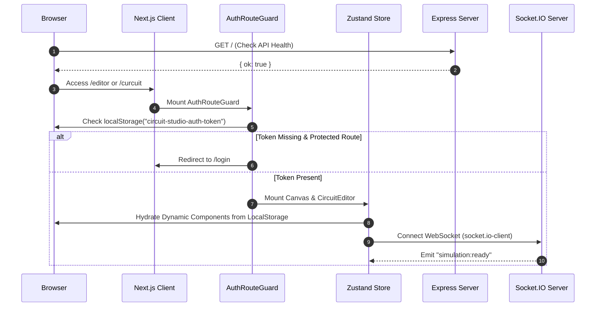
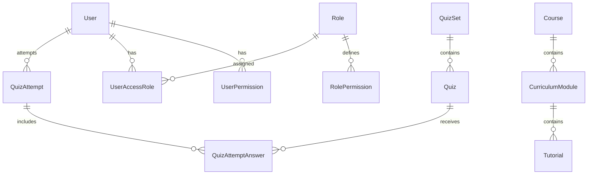
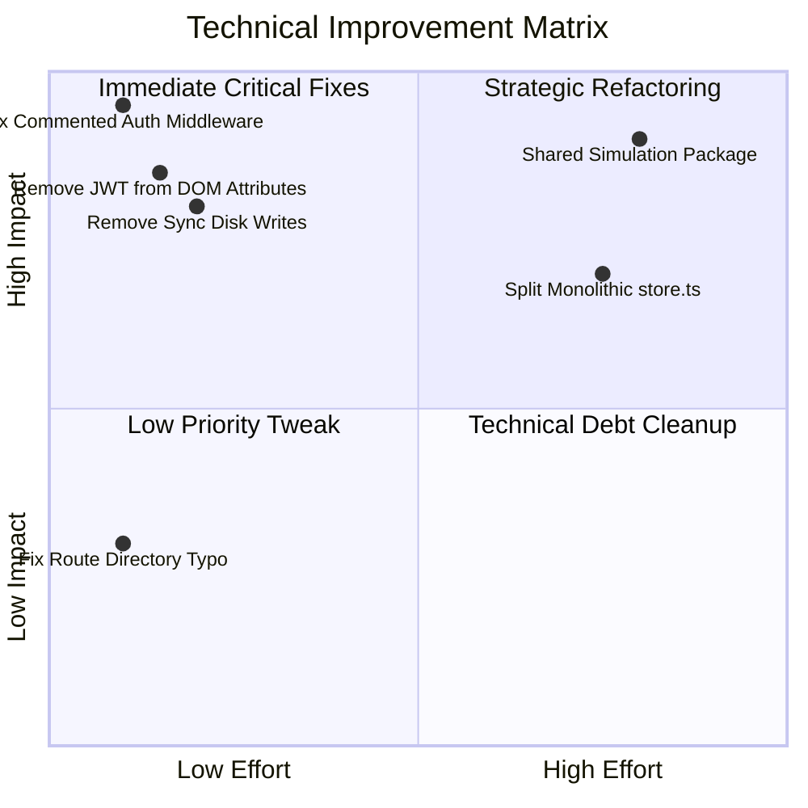
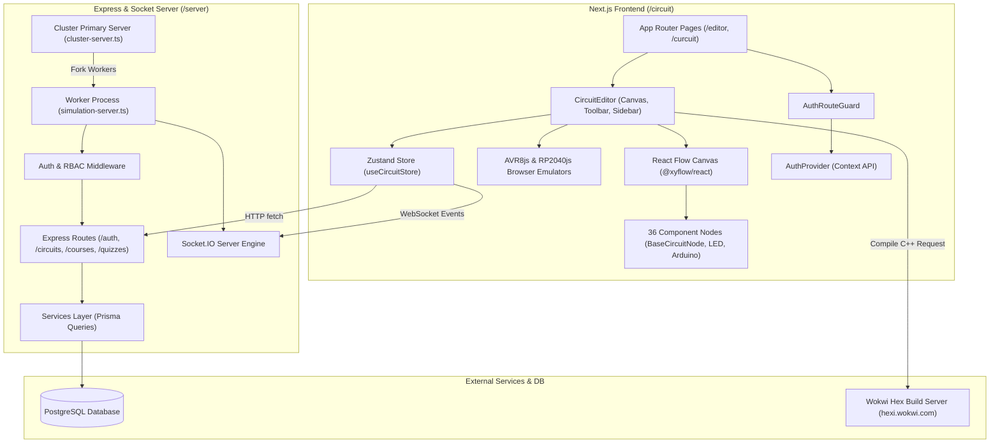

I will explore the subdirectories of both `circuit/src` and `server` to build an accurate folder tree and component map for the architectural analysis.

Listed directory blocks

I will list the contents of `circuit/src/generators`, `circuit/src/provider`, and `circuit/src/utils`.

Listed directory generators

I will list `circuit/src/provider` and `circuit/src/utils`.

Listed directory provider

I will list `circuit/src/utils`.

Listed directory utils

I will list the contents of `circuit/src/components/edges`, `circuit/src/components/blockly`, `circuit/src/components/dashboard`, `circuit/src/components/auth`, `circuit/src/components/quiz`, and `circuit/src/components/ui`.

Listed directory edges

I will list the remaining subdirectories in `circuit/src/components`.

Listed directory blockly

I will check `dashboard`, `auth`, `quiz`, and `ui` under `circuit/src/components`.

Listed directory dashboard

I will list `auth`, `quiz`, and `ui` in `circuit/src/components`.

Listed directory auth

I will list `circuit/src/components/quiz` and `circuit/src/components/ui`.

Listed directory quiz

I will list the subdirectories of `circuit/src/lib/`.

Listed directory circuit

I will list `circuit/src/lib/codeParsing` and `circuit/src/lib/simulation`.

Listed directory codeParsing

I will list `circuit/src/lib/simulation`.

Listed directory simulation

I will check the subdirectories in `server/`.

Listed directory controllers

I will list `server/services`, `server/middlewares`, `server/helpers`, `server/validation`, and `server/config`.

Listed directory services

I will check `server/middlewares`, `server/helpers`, `server/validation`, and `server/config`.

Listed directory middlewares

I will list `server/helpers`, `server/validation`, and `server/config`.

Listed directory helpers

I will check `server/validation` and `server/config`.

Listed directory validation

I will list `server/config`.

Listed directory config

I will view `server/package.json` to inspect backend dependencies and scripts.

Viewed package.json:1-47

I will view `server/simulation-server.ts` to examine the backend application setup and server initialization.

Viewed simulation-server.ts:1-100

I will view lines 101 to 200 of `server/simulation-server.ts`.

Viewed simulation-server.ts:101-200

I will view lines 201 to 300 of `server/simulation-server.ts`.

Viewed simulation-server.ts:201-300

I will view `server/middlewares/auth.middleware.ts` to analyze authentication and authorization logic.

Viewed auth.middleware.ts:1-66

I will view `server/helpers/auth.helper.ts` to inspect token generation and verification logic.

Viewed auth.helper.ts:1-107

I will view `server/cluster-server.ts` to inspect how clustering and worker process setup are structured.

Viewed cluster-server.ts:1-97

I will view `circuit/src/provider/AuthProvider.tsx` to inspect the frontend authentication context.

Viewed AuthProvider.tsx:1-63

I will view `circuit/src/components/auth/AuthRouteGuard.tsx` to see how client-side page protection works.

Viewed AuthRouteGuard.tsx:1-41

I will view `circuit/src/lib/server-api.ts` to inspect frontend API configuration.

Viewed server-api.ts:1-12

I will search for `fetch(` or `axios` in `circuit/src` to see API communication methods.

Searched for "fetch("

I will view `server/prisma/schema.prisma` to examine the Prisma setup.

Viewed schema.prisma:1-9

I will view `server/prisma/models/enums.prisma` and `server/prisma/models/user.prisma`.

Viewed user.prisma:1-26

I will view `server/prisma/models/circuit.prisma`.

Viewed circuit.prisma:1-15

I will view `circuit/src/app/curcuit/page.tsx` to inspect page routing and typo check.

Viewed page.tsx:1-135

# 1. High-Level Overview

### Project Purpose
**Circuit Studio** (Robotics Circuit) is an interactive, browser-based 2D/3D electronic circuit design and simulation platform (an open-source alternative to Tinkercad Circuits and Wokwi) combined with an educational Learning Management System (LMS). It enables users to:
1. Visually drag and drop electronic components (Arduino, Raspberry Pi Pico, LEDs, Resistors, Sensors, Motors, Oscilloscopes, Multimeters, Breadboards) on an interactive canvas.
2. Wire pin terminals and evaluate electronic circuit dynamics (voltage drops, resistance networks, current flow, LED burnt states).
3. Write micro-controller code using C++ (Monaco Editor) or visual block coding (Google Blockly), compile code into Hex/ELF binaries, and run real-time hardware emulation in the browser (via `avr8js` and `rp2040js`) or through a backend socket server.
4. Access educational courses, tutorials, quizzes, component guides, and role-based class management.

---

### Tech Stack

| Layer | Technologies Used |
| :--- | :--- |
| **Frontend Framework** | Next.js (v16.2.9 App Router), React 19, TypeScript |
| **UI & Styling** | TailwindCSS v4, Lucide React Icons, React Three Fiber (`@react-three/fiber`, `@react-three/drei`, `three`) |
| **Canvas & Wiring** | React Flow (`@xyflow/react`), Wokwi Elements (`@wokwi/elements`) web components |
| **Code Editors & Logic** | Monaco Editor (`@monaco-editor/react`), Google Blockly (`blockly`), Custom C++ & MicroPython code generators |
| **Hardware Emulators** | `avr8js` (8-bit AVR microcontrollers), `rp2040js` (Raspberry Pi Pico) |
| **Frontend State** | Zustand v5, React Context API (`AuthProvider`) |
| **Backend Framework** | Node.js, Express.js v5, TypeScript (`tsx`) |
| **Real-time WebSockets** | Socket.IO v4 (`@socket.io/sticky`, `@socket.io/cluster-adapter`) |
| **Database & ORM** | PostgreSQL, Prisma ORM v6.19 (Multi-file schema structure) |
| **Auth & Security** | JWT (`jsonwebtoken`), `bcryptjs`, Custom Express Middlewares |
| **FileUpload & Utilities**| Multer, Nodemailer, Zod, Axios |

---

### Architecture Style
- **Monorepo Architecture**: Contains two primary independent Node.js packages:
  1. `circuit/`: Next.js Client-Side Single Page Application & Simulation Engine.
  2. `server/`: Express REST API & Multi-Process Socket.IO Simulation Server.
- **Client-Side Heavy Simulation**: Circuit graph evaluation, breadboard snapping, and AVR micro-controller CPU cycles execute directly in the user's browser for zero-latency interactivity, with fallback/sync to the backend Socket server.
- **Cluster Master-Worker Pattern**: Backend uses Node.js `cluster` with sticky IP load balancing and cluster adapter for real-time WebSocket scaling.

---

### Entry Points

| Side | Environment | Entry File | Responsibility |
| :--- | :--- | :--- | :--- |
| **Frontend** | Browser / Client | [`circuit/src/app/page.tsx`](file:///c:/Users/Public/valorix/Robotics_Circuit/circuit/src/app/page.tsx) | Landing / Studio Dashboard entry |
| **Frontend** | Browser / Client | [`circuit/src/app/editor/page.tsx`](file:///c:/Users/Public/valorix/Robotics_Circuit/circuit/src/app/editor/page.tsx) | Pure Circuit Editor route |
| **Frontend** | Browser / Client | [`circuit/src/app/curcuit/page.tsx`](file:///c:/Users/Public/valorix/Robotics_Circuit/circuit/src/app/curcuit/page.tsx) | Full Studio route with topbar, sidebar & DB loader |
| **Backend** | Single Process | [`server/simulation-server.ts`](file:///c:/Users/Public/valorix/Robotics_Circuit/server/simulation-server.ts) | Express API & Socket.IO server initialization |
| **Backend** | Cluster Mode | [`server/cluster-server.ts`](file:///c:/Users/Public/valorix/Robotics_Circuit/server/cluster-server.ts) | Primary cluster process forking worker threads |

---

### Build System & Tooling
- **Frontend**: Next.js CLI (`next dev`, `next build --webpack`).
- **Backend**: `tsx` execution engine (`tsx watch simulation-server.ts`), `tsc` TypeScript compiler for production compilation.
- **Database Tooling**: Prisma CLI (`npx prisma migrate dev`, `npx prisma generate`, `npx prisma db seed`).

---

### Environment Configuration

#### 1. Frontend (`circuit/.env`)
- `NEXT_PUBLIC_API_BASE_URL`: Base HTTP URL pointing to the Express backend API (e.g. `http://localhost:4010`).

#### 2. Backend (`server/.env`)
- `SIM_SERVER_PORT`: Port for backend Express & Socket.IO server (Default: `4010`).
- `CLUSTER_WORKERS`: Number of worker threads for Node.js clustering (Default: `2`, Max: `8`).
- `MAX_ACTIVE_SIMULATIONS`: Maximum concurrent backend simulations permitted per process.
- `JWT_SECRET`: Secret key for signing and verifying 7-day authentication tokens.
- `DATABASE_URL`: PostgreSQL connection string.

---

# 2. Complete Folder Structure

```
Robotics_Circuit/
├── .gitignore
├── README.md
├── package-lock.json
│
├── circuit/                          # Frontend Next.js Application
│   ├── .env
│   ├── eslint.config.mjs
│   ├── next.config.ts
│   ├── package.json
│   ├── postcss.config.mjs
│   ├── tsconfig.json
│   ├── public/                       # Static SVGs, 3D models & assets
│   └── src/
│       ├── app/                      # Next.js App Router Page Routes
│       │   ├── globals.css
│       │   ├── layout.tsx
│       │   ├── loading.tsx
│       │   ├── not-found.tsx
│       │   ├── page.tsx
│       │   ├── cad/
│       │   ├── class-syllabus/
│       │   ├── classes/
│       │   ├── collections/
│       │   ├── component_info/
│       │   ├── curcuit/              # Full Studio layout (Contains typo in folder name)
│       │   │   └── page.tsx
│       │   ├── editor/               # Standalone editor route
│       │   │   └── page.tsx
│       │   ├── login/
│       │   ├── profile/
│       │   ├── projects/
│       │   ├── quizzes/
│       │   ├── register/
│       │   └── tutorials/
│       ├── blocks/                   # Blockly custom block definition logic
│       │   └── arduinoBlocks.ts
│       ├── components/               # React UI Components
│       │   ├── ClientSimulationBind.tsx
│       │   ├── InfoButton.tsx
│       │   ├── InfoPopup.tsx
│       │   ├── auth/                 # Login/Register UI & Auth Guard
│       │   │   ├── AuthPage.tsx
│       │   │   └── AuthRouteGuard.tsx
│       │   ├── blockly/              # Blockly canvas component
│       │   │   └── BlocklyEditor.tsx
│       │   ├── circuit-editor/       # Core Editor UI Panels
│       │   │   ├── ArduinoCloudPanel.tsx
│       │   │   ├── BlocklyEditor.tsx
│       │   │   ├── Canvas.tsx        # React Flow circuit board
│       │   │   ├── CircuitEditor.tsx # Main grid layout wrapper
│       │   │   ├── CodeEditor.tsx   # Monaco C++ editor
│       │   │   ├── ComponentGuidePanel.tsx
│       │   │   ├── CustomPresetBuilder.tsx
│       │   │   ├── DynamicComponentForm.tsx
│       │   │   ├── EditorPanel.tsx
│       │   │   ├── MonacoEditor.tsx
│       │   │   ├── PropertiesPanel.tsx
│       │   │   ├── SerialMonitor.tsx
│       │   │   ├── Sidebar.tsx      # Palette of electronic parts
│       │   │   ├── SimulationPanel.tsx
│       │   │   ├── Toolbar.tsx      # Top editor toolbar
│       │   │   └── parseCompilerErrors.ts
│       │   ├── dashboard/            # LMS & User Studio Dashboard UI
│       │   ├── edges/                # Custom React Flow Edge wires
│       │   │   ├── SparkConnectionLine.tsx
│       │   │   └── WireEdge.tsx
│       │   ├── nodes/                # 36 Custom React Flow Node components
│       │   │   ├── BaseCircuitNode.tsx
│       │   │   ├── ArduinoNode.tsx
│       │   │   ├── BreadboardNode.tsx
│       │   │   ├── LEDNode.tsx
│       │   │   ├── ResistorNode.tsx
│       │   │   ├── MotorNode.tsx
│       │   │   └── ... (30+ additional components)
│       │   ├── quiz/                 # Educational quiz interfaces
│       │   └── ui/                   # Shared UI Skeletons & Widgets
│       ├── generators/               # Code Translators
│       │   ├── arduinoGenerator.ts
│       │   └── pythonGenerator.ts
│       ├── hooks/                    # React Hooks
│       │   ├── getter.ts
│       │   └── useSetterRow.ts
│       ├── lib/                      # Core Circuit Engine & Business Logic
│       │   ├── arduino-cloud-store.ts
│       │   ├── arduino-cloud.ts
│       │   ├── arduino-l293d-car-frame.ts
│       │   ├── arduino-simulator.ts  # Hex compilation & hex solver
│       │   ├── avr-runner.ts         # avr8js execution wrapper
│       │   ├── blockly-store.ts
│       │   ├── breadboard-autoconnect.ts
│       │   ├── circuit-components.ts # Master catalog of electronic parts
│       │   ├── circuit-cross-tab-sync.ts
│       │   ├── circuit-presets.ts    # Pre-wired circuit templates
│       │   ├── intelhex.ts
│       │   ├── quiz-utils.ts
│       │   ├── resistor-network-analyzer.ts # Electrical solver
│       │   ├── server-api.ts
│       │   ├── servo-motion.ts
│       │   ├── simulation-session.ts
│       │   ├── simulation-state.ts   # Core circuit frame evaluator
│       │   ├── simulation.ts
│       │   ├── socket-client.ts      # Socket.IO client instance
│       │   ├── store-legacy.ts
│       │   ├── store.ts              # Monolithic Zustand state store (~8.7k lines)
│       │   ├── types.ts              # Core TypeScript interfaces
│       │   ├── circuit/              # Conductive Graph & breadboard parsing
│       │   ├── codeParsing/          # Code AST/regex parsers for pin state
│       │   ├── simulation/           # Frame pipeline & state maps
│       │   └── store/                # Sliced Zustand stores
│       ├── provider/                 # Context Providers
│       │   └── AuthProvider.tsx      # Auth token context provider
│       ├── store/                    # Additional UI/Component stores
│       │   ├── useBlocklyStore.ts
│       │   ├── useCustomPresetsStore.ts
│       │   ├── useDynamicComponentsStore.ts
│       │   └── useEditorPanelStore.ts
│       ├── types/
│       └── utils/
│           ├── componentStatus.ts    # Warning & Overvoltage checker
│           └── connectivity.ts       # Graph connectivity analyzer
│
└── server/                           # Backend Express & Socket.IO Application
    ├── .env
    ├── .env.example
    ├── cluster-server.ts             # Primary Cluster entry point
    ├── docker-compose.yml            # PostgreSQL Docker configuration
    ├── package.json
    ├── prisma.config.ts
    ├── simulation-server.ts          # Express API & Socket.IO server initialization
    ├── tsconfig.json
    ├── config/                       # Prisma client instance singleton
    │   └── prisma.ts
    ├── controllers/                  # Express HTTP Controller layer (11 controllers)
    │   ├── auth.controller.ts
    │   ├── circuit.controller.ts
    │   ├── component-guide.controller.ts
    │   ├── course.controller.ts
    │   ├── curriculum-module.controller.ts
    │   ├── media.controller.ts
    │   ├── quiz.controller.ts
    │   ├── role.controller.ts
    │   ├── student.controller.ts
    │   ├── subject.controller.ts
    │   └── tutorial.controller.ts
    ├── helpers/                      # Request validation & response formatters
    ├── middlewares/                  # Express Middlewares
    │   ├── auth.middleware.ts        # JWT verification & Permission checking
    │   ├── error.middleware.ts       # Global Error Handler
    │   ├── guide-upload.middleware.ts# Multer file upload handler
    │   └── rate-limit.middleware.ts  # Express rate limiter
    ├── prisma/                       # Database Configuration & Seeds
    │   ├── schema.prisma             # Base generator & datasource definition
    │   ├── seed.ts                   # SuperAdmin & default role seeder
    │   └── models/                   # Modular Prisma schema files (15 models)
    │       ├── user.prisma
    │       ├── circuit.prisma
    │       ├── course.prisma
    │       ├── quiz.prisma
    │       └── ...
    ├── routes/                       # Express Route Definitions (11 route files)
    ├── services/                     # Business Logic & DB queries (13 service modules)
    ├── simulation/                   # Server-side Simulation Engine (Duplicated from client)
    └── validation/                   # Zod Validation schemas
```

---

### Key Folder Responsibilities

1. **`circuit/src/app/`**: Next.js 16 App Router. Handles page routing, layouts, page skeletons, and client-side page rendering.
2. **`circuit/src/components/circuit-editor/`**: Contains all modular UI panels composing the circuit studio (Canvas, Sidebar, Code Editor, Blockly Editor, Properties, Toolbar).
3. **`circuit/src/components/nodes/`**: Custom React Flow node components rendering Wokwi vector elements, handling terminal hitboxes, pin coordinates, and component status overlays.
4. **`circuit/src/lib/`**: The heart of the simulation engine. Contains the electrical circuit solver (`simulation-state.ts`, `resistor-network-analyzer.ts`), microcontroller runners (`avr-runner.ts`), code parsers, and global Zustand stores (`store.ts`).
5. **`server/controllers/`**: Express HTTP request handlers receiving requests, sanitizing inputs, calling service methods, and returning JSON responses.
6. **`server/services/`**: Encapsulates database transactions via Prisma ORM, business rules, and external integrations (e.g., mail, AI quiz generator).
7. **`server/middlewares/`**: Security layer handling JWT extraction, role/permission authorization, rate limiting, and global error catch blocks.
8. **`server/prisma/models/`**: Modular database model definitions combined by Prisma into a single unified database schema.

---

# 3. Application Flow

### Boot Sequence



---

### Key System Workflows

1. **Routing**:
   - Client-side navigation handled by Next.js App Router (`next/navigation`).
   - [`AuthRouteGuard`](file:///c:/Users/Public/valorix/Robotics_Circuit/circuit/src/components/auth/AuthRouteGuard.tsx) checks path privacy against `publicPaths` (`/login`, `/register`). If unauthenticated, user is redirected to `/login`.

2. **Authentication Flow**:
   - User submits credentials at `/login` -> calls `POST /auth/login`.
   - Server authenticates password via `bcryptjs.compare`, generates a 7-day JWT token signed with `JWT_SECRET`.
   - Client stores token in `localStorage` under key `circuit-studio-auth-token` and sets `document.documentElement.setAttribute("data-token", token)`.
   - Subsequent HTTP requests include `Authorization: Bearer <token>`.

3. **State Management Flow**:
   - React Flow handles drag position updates, selection, and viewport panning.
   - On node drag or connection completion, React Flow callbacks dispatch events to `useCircuitStore`.
   - State changes push history records to `history.past` for undo/redo capability.

4. **Simulation Engine Flow**:
   - User clicks **"Start Simulation"** in [`Toolbar.tsx`](file:///c:/Users/Public/valorix/Robotics_Circuit/circuit/src/components/circuit-editor/Toolbar.tsx).
   - If C++ code exists, client sends code to `https://hexi.wokwi.com/build` to compile to Intel HEX format.
   - `avr-runner.ts` initializes `AVRCpu` and loads HEX bytes.
   - An animation frame loop invokes `buildSimulationFrame()` at 30 FPS, computing conductive graphs (`graph.ts`), resistor equivalent resistance (`resistor-network-analyzer.ts`), and digital/analog pin values.
   - Component state telemetry (voltage, spark, glow, motor speed) updates in `useCircuitStore.simulationFrame`, causing UI nodes to re-render.

5. **API & Database Flow**:
   - REST API requests hit Express endpoints (`/circuits`, `/courses`, `/quizzes`).
   - Controllers call Services -> Services invoke Prisma Client -> PostgreSQL DB.
   - Responses are normalized via [`response.helper.ts`](file:///c:/Users/Public/valorix/Robotics_Circuit/server/helpers/response.helper.ts).

6. **Error Handling**:
   - Express uses async wrapper handlers passing errors to `next(error)`.
   - Global [`errorHandler`](file:///c:/Users/Public/valorix/Robotics_Circuit/server/middlewares/error.middleware.ts) formats errors into JSON `{ ok: false, error: message }`.
   - Client handles HTTP errors with `react-toastify` popups or UI banner messages.

7. **Background Jobs / Real-time Relays**:
   - No offline queue (Redis/BullMQ) is present.
   - Server provides an Server-Sent Events (SSE) endpoint `/cad-stream` to broadcast real-time simulation frames to external CAD viewers.

---

# 4. Core Modules

### 1. Circuit Canvas & Editing Module
- **Purpose**: Interactive visual design board for components and wiring.
- **Dependencies**: `@xyflow/react`, `uuid`, `useCircuitStore`.
- **Main Files**: [`Canvas.tsx`](file:///c:/Users/Public/valorix/Robotics_Circuit/circuit/src/components/circuit-editor/Canvas.tsx), [`CircuitEditor.tsx`](file:///c:/Users/Public/valorix/Robotics_Circuit/circuit/src/components/circuit-editor/CircuitEditor.tsx), [`Sidebar.tsx`](file:///c:/Users/Public/valorix/Robotics_Circuit/circuit/src/components/circuit-editor/Sidebar.tsx).
- **Internal Workflow**: Sidebar items drop onto React Flow canvas -> canvas calculates snapped position (breadboard snapping) -> updates Zustand `nodes` array -> renders corresponding custom node component.

### 2. Node Components & Visual Parts Module
- **Purpose**: Render realistic electronics SVG elements and pin hitboxes.
- **Dependencies**: `@wokwi/elements`, `BaseCircuitNode.tsx`.
- **Main Files**: 36 node files in [`circuit/src/components/nodes/`](file:///c:/Users/Public/valorix/Robotics_Circuit/circuit/src/components/nodes/).
- **Internal Workflow**: Receive `NodeProps<CircuitNode>` -> `BaseCircuitNode` calculates pin coordinates and rotation matrices -> renders vector graphic -> listens for pin click events to start drawing wires.

### 3. Circuit Simulation Engine
- **Purpose**: Solve electrical circuits, simulate voltage/current, and emulate microcontrollers.
- **Dependencies**: `avr8js`, `rp2040js`, `intelhex`.
- **Main Files**: [`simulation-state.ts`](file:///c:/Users/Public/valorix/Robotics_Circuit/circuit/src/lib/simulation-state.ts), [`avr-runner.ts`](file:///c:/Users/Public/valorix/Robotics_Circuit/circuit/src/lib/avr-runner.ts), [`resistor-network-analyzer.ts`](file:///c:/Users/Public/valorix/Robotics_Circuit/circuit/src/lib/resistor-network-analyzer.ts), [`graph.ts`](file:///c:/Users/Public/valorix/Robotics_Circuit/circuit/src/lib/circuit/graph.ts).
- **Internal Workflow**: Build graph of connected pins -> find power sources (Battery, Power Supply, VCC pins) -> compute voltage drops and currents -> execute CPU cycles -> publish `SimulationFrame`.

### 4. Code Generation & Parsing Module
- **Purpose**: Translate visual Blockly blocks to Arduino C++ / Python, and parse C++ code for pin declarations.
- **Dependencies**: `blockly`.
- **Main Files**: [`arduinoGenerator.ts`](file:///c:/Users/Public/valorix/Robotics_Circuit/circuit/src/generators/arduinoGenerator.ts), [`arduinoParser.ts`](file:///c:/Users/Public/valorix/Robotics_Circuit/circuit/src/lib/codeParsing/arduinoParser.ts).
- **Internal Workflow**: AST/Regex parsing extracts `pinMode()`, `digitalWrite()`, `analogRead()`, and `lcd.print()` invocations to inform visual simulator state without full CPU compilation when running in fallback mode.

### 5. Backend Server & Socket Module
- **Purpose**: Host REST API services, user management, and WebSocket-based backend simulation orchestration.
- **Dependencies**: `express`, `socket.io`, `@socket.io/sticky`, `@socket.io/cluster-adapter`, `@prisma/client`.
- **Main Files**: [`simulation-server.ts`](file:///c:/Users/Public/valorix/Robotics_Circuit/server/simulation-server.ts), [`cluster-server.ts`](file:///c:/Users/Public/valorix/Robotics_Circuit/server/cluster-server.ts), `server/routes/*`, `server/services/*`.

---

# 5. Components Breakdown

| Component Name | Inputs (Props) | Outputs (Emits/Events) | Internal State | Side Effects | Reusability | Key Dependencies |
| :--- | :--- | :--- | :--- | :--- | :--- | :--- |
| **`CircuitEditor`** | `embedded?: boolean` | Layout rendering | Responsive grid layout classes | Wraps UI in `ReactFlowProvider` | High | `@xyflow/react`, `Canvas`, `Toolbar` |
| **`Canvas`** | None (Reads Zustand) | Selection events, Node move, Wire connect | `connectionWaypoints`, `draftWire`, `ghostPosition` | Window keydown listener ('R' key for rotation) | Medium (Editor core) | `@xyflow/react`, `useCircuitStore` |
| **`BaseCircuitNode`** | `width`, `height`, `pins`, `children` | Pin click, Node click | `hoveredPin`, `nodeHovered`, `popupOpen` | Calculates rotation matrices & hitboxes | High (Wrapper for all 36 nodes) | `@xyflow/react`, `useCircuitStore` |
| **`CodeEditor`** | None (Reads Zustand) | Code updates | `activeTab`, `isCompiling` | Fetches hex binaries from Wokwi build server | Low (Editor panel) | `@monaco-editor/react`, `useCircuitStore` |
| **`BlocklyEditor`** | None (Reads Zustand) | Generated C++/Python code | `workspace` ref | Inits Google Blockly workspace in DOM | Medium | `blockly`, `arduinoGenerator` |
| **`Toolbar`** | None (Reads Zustand) | Starts/Stops simulation, saves circuit | `isSaving`, `presetMenuOpen` | Emits HTTP requests to save circuit to DB | Low (Header control) | `useCircuitStore`, `serverApiUrl` |
| **`AuthRouteGuard`**| `children: ReactNode` | Page redirection | `allowed: boolean` | Checks `localStorage` & redirects to `/login` | High (Global Guard) | `next/navigation` |

---

# 6. API Layer

### REST API Structure

The backend exposes REST endpoints under prefix routes:

| Route Prefix | Controller | Access Protection | Description |
| :--- | :--- | :--- | :--- |
| `/auth` | `auth.controller.ts` | Public | User Registration (`/register`), Login (`/login`), Profile (`/me`) |
| `/circuits` | `circuit.controller.ts` | Token / Public | List, Create, Fetch by ID, Update, Delete, Like circuits |
| `/courses` | `course.controller.ts` | Token + Permission | Course creation, updating, publishing, archiving |
| `/quizzes` | `quiz.controller.ts` | Token | Fetch quizzes, submit quiz answers, AI quiz generation |
| `/component-guides` | `component-guide.controller.ts` | Token + Permission | CRUD endpoints for hardware component docs & media uploads |
| `/roles` | `role.controller.ts` | SuperAdmin | Role & permission assignment for user access control |
| `/media` | `media.controller.ts` | Token | Handles image/video/GLB file uploads via Multer |

---

### Fetch Logic & Authentication Handling
- **Client Fetch Call Pattern**: Direct native `fetch` calls using helper `serverApiUrl(path)`.
- **Request Headers**: Manually attaches `Authorization: Bearer <token>` fetched from `localStorage`.
- **No Global Axios Interceptor**: Fetch logic is repeated across component files (`AuthPage.tsx`, `CircuitsSection.tsx`, `ComponentGuidePanel.tsx`, `Toolbar.tsx`), leading to duplicate error handling logic.

---

# 7. State Management

### 1. Global Zustand Stores

#### `useCircuitStore` (Monolithic Store in [`lib/store.ts`](file:///c:/Users/Public/valorix/Robotics_Circuit/circuit/src/lib/store.ts))
Contains full application state for:
- **Canvas State**: `nodes`, `edges`, `selectedNodeIds`, `selectedEdgeIds`, `wireColor`.
- **Simulation State**: `isSimulating`, `simulationStatus`, `simulationFrame`, `poweredNodeIds`, `nodeVoltages`.
- **Microcontroller State**: `arduinoCode`, `picoCode`, `arduinoPins`, `serialOutput`.
- **History State**: `history: { past: [...], future: [...] }`.

#### Sliced Zustand Stores (`circuit/src/lib/store/`)
Modularized slices (`circuitSlice.ts`, `simulationSlice.ts`, `codeSlice.ts`, `uiSlice.ts`) designed to break up `store.ts`.

#### Specialized UI Stores (`circuit/src/store/`)
- `useDynamicComponentsStore`: User-created component definitions synced with `localStorage`.
- `useCustomPresetsStore`: Custom circuit presets.
- `useBlocklyStore`: Active Blockly workspace state.
- `useEditorPanelStore`: Sidebar & properties panel visibility flags.

### 2. React Context (`AuthProvider`)
- Wraps application root in [`AuthProvider.tsx`](file:///c:/Users/Public/valorix/Robotics_Circuit/circuit/src/provider/AuthProvider.tsx).
- Maintains `token` state synced to `localStorage.getItem("circuit-studio-auth-token")`.

---

# 8. Database / Data Models

The backend utilizes **Prisma ORM v6.19** connected to PostgreSQL. The schema is organized into 15 model files in `server/prisma/models/`:



### Primary Entity Models

1. **`User`** (`user.prisma`):
   - Fields: `id`, `name`, `email` (unique), `passwordHash`, `classLevel`, `role` (`USER` | `SUPERADMIN`), `studentProfile` (JSON).
2. **`Circuit`** (`circuit.prisma`):
   - Fields: `id`, `name`, `nodes` (JSON), `edges` (JSON), `arduinoCode`, `picoCode`, `thumbnailPath`, `accessMode`, `ownerEmail`, `invitedEmails` (JSON), `likedByEmails` (JSON).
3. **`Course`** (`course.prisma`):
   - Fields: `id`, `title`, `instructorName`, `status` (`DRAFT` | `PUBLISHED` | `ARCHIVED`), `moduleCount`, `coverColor`, `icon`.
4. **`ComponentGuide`** (`component-guide.prisma`):
   - Fields: `id`, `name`, `slug` (unique), `iconUrl`, `sections` (JSON).
5. **`QuizSet` & `Quiz`** (`quiz.prisma`):
   - Stores multiple-choice questions, correct option indexes, explanations, and student score attempts (`QuizAttempt`).

---

# 9. Configuration

| Config File | Target | Purpose |
| :--- | :--- | :--- |
| [`circuit/tsconfig.json`](file:///c:/Users/Public/valorix/Robotics_Circuit/circuit/tsconfig.json) | Frontend | TypeScript options & path alias mapping (`"@/*": ["./src/*"]`) |
| [`circuit/next.config.ts`](file:///c:/Users/Public/valorix/Robotics_Circuit/circuit/next.config.ts) | Frontend | Next.js build configuration |
| [`server/docker-compose.yml`](file:///c:/Users/Public/valorix/Robotics_Circuit/server/docker-compose.yml) | Backend | Local PostgreSQL container setup on port `5432` |
| [`server/prisma/schema.prisma`](file:///c:/Users/Public/valorix/Robotics_Circuit/server/prisma/schema.prisma)| Backend | Prisma generator & PostgreSQL datasource setup |
| [`server/prisma.config.ts`](file:///c:/Users/Public/valorix/Robotics_Circuit/server/prisma.config.ts) | Backend | Prisma CLI schema search path configuration |

---

# 10. Dependency Analysis

### Critical External Packages

| Library | Package | Justification / Purpose in Project |
| :--- | :--- | :--- |
| **React Flow** | `@xyflow/react` | Core engine rendering nodes, ports, drag behavior, and dynamic wires. |
| **Wokwi Elements**| `@wokwi/elements` | Web components providing vector graphics for real electronic components. |
| **AVR Emulator** | `avr8js` | Executes compiled 8-bit AVR Arduino binaries in JavaScript. |
| **RP2040 Emulator**| `rp2040js` | Emulates Raspberry Pi Pico ARM Cortex-M0+ microcontroller. |
| **Blockly** | `blockly` | Provides visual drag-and-drop block coding interface for students. |
| **Monaco Editor** | `@monaco-editor/react` | Embedded VS Code Monaco editor for C++ and Python syntax highlighting. |
| **Socket.IO** | `socket.io` / `socket.io-client` | Real-time bi-directional streaming of simulation frames & cluster sync. |
| **Prisma ORM** | `@prisma/client` | Type-safe database queries and automated schema migrations. |

---

# 11. Performance Analysis

### Identified Bottlenecks & Issues

1. **Monolithic Store In Memory**:
   - `circuit/src/lib/store.ts` is ~8,728 lines (275 KB). Importing this file in dozens of React components causes massive bundle bloat and causes unnecessary full-tree re-renders when deep state updates occur.
2. **Synchronous Disk I/O on Socket Events**:
   - In [`server/simulation-server.ts`](file:///c:/Users/Public/valorix/Robotics_Circuit/server/simulation-server.ts) line 300:
     ```ts
     fs.writeFileSync(path.join(__dirname, 'last_start_payload.json'), JSON.stringify(payload, null, 2));
     ```
     Every time any user starts a simulation, the server synchronously writes a multi-megabyte JSON payload to disk, blocking the Node.js event loop for all connected WebSocket clients!
3. **External Remote Compiler Dependency**:
   - Arduino code compilation relies on an external API call to `https://hexi.wokwi.com/build`. If this third-party endpoint rate-limits or goes down, local C++ compilation fails.
4. **DOM Attribute State Leak**:
   - `AuthProvider.tsx` sets `document.documentElement.setAttribute("data-token", token)` on every state change, triggering DOM MutationObserver alerts and style recalculations across the whole document.

---

# 12. Security Review

### 🚨 Critical Security Vulnerabilities Found

#### 1. Commented-Out Permission Checking (Authorization Bypass)
- **Location**: [`server/middlewares/auth.middleware.ts`](file:///c:/Users/Public/valorix/Robotics_Circuit/server/middlewares/auth.middleware.ts) (Lines 46–57)
- **Vulnerability**:
  ```typescript
  const grant = await prisma.user.findFirst({
    where: {
      id: auth.sub,
      // OR: [
      // { permissions: { some: { permission } } },
      // { roles: { some: { role: { permissions: { some: { permission } } } } } },
      // ],
    },
    select: { id: true },
  });
  ```
- **Impact**: The database condition checking if the user actually has the requested `permission` is commented out! Any authenticated user passes `requirePermission()` checks, granting non-admin users access to protected course and component guide operations.

#### 2. JWT Exposed in Plain DOM Attributes
- **Location**: [`circuit/src/provider/AuthProvider.tsx`](file:///c:/Users/Public/valorix/Robotics_Circuit/circuit/src/provider/AuthProvider.tsx) (Line 35)
- **Vulnerability**: `document.documentElement.setAttribute("data-token", token);`
- **Impact**: The JWT access token is written directly to the root `<html>` element attribute. Any Cross-Site Scripting (XSS) snippet or malicious browser extension can inspect the DOM tree and exfiltrate user credentials.

#### 3. Hardcoded Default Secrets in Readme / Environment Examples
- **Location**: `README.md` and `.env.example`
- **Vulnerability**: `JWT_SECRET="use-at-least-32-random-characters"`
- **Impact**: If deployed to production without overriding `JWT_SECRET`, attackers can forge valid `SUPERADMIN` JWT tokens using the known secret.

#### 4. CORS Allowed Origins Code Hardcoding
- **Location**: [`server/simulation-server.ts`](file:///c:/Users/Public/valorix/Robotics_Circuit/server/simulation-server.ts) (Lines 48–58)
- **Vulnerability**: Hardcoded IP addresses (`http://134.195.138.214:5001`, etc.) in application code instead of reading dynamically from environment variables.

---

# 13. Code Quality

1. **Typo in Next.js Route Directory Name**:
   - Directory `circuit/src/app/curcuit/` is misspelled (`curcuit` instead of `circuit`).
2. **Duplicated Engine Files**:
   - Identical simulation logic files exist in both `circuit/src/lib/` and `server/simulation/` (`arduino-simulator.ts`, `avr-runner.ts`, `breadboard-autoconnect.ts`, `circuit-components.ts`, `simulation-state.ts`). These should be extracted into a shared npm package or workspace module.
3. **Dual Store Architecture (Technical Debt)**:
   - Both `circuit/src/lib/store.ts` (monolithic) and `circuit/src/lib/store/` (sliced stores) exist simultaneously, causing confusion regarding which store holds ground truth.
4. **Violations of SOLID Principles**:
   - `Canvas.tsx` (729 lines) and `store.ts` (8,728 lines) violate the Single Responsibility Principle by combining UI rendering, drag math, network sockets, AST parsing, and state storage in single files.

---

# 14. Improvement Suggestions



### Categorized Recommendations

#### Critical Priority (Fix Immediately)
1. **Fix Authorization Middleware**: Uncomment the `OR` permissions check in `server/middlewares/auth.middleware.ts` to enforce RBAC permissions.
2. **Remove JWT DOM Leak**: Remove `document.documentElement.setAttribute("data-token", token)` from `AuthProvider.tsx`.
3. **Remove Synchronous Disk Write**: Delete `fs.writeFileSync(...)` in `server/simulation-server.ts` to prevent blocking the Node.js event loop during simulation start.

#### High Priority
1. **Consolidate Store Architecture**: Fully migrate from the 8.7k-line monolithic `lib/store.ts` to modular Zustand slices under `lib/store/`.
2. **Share Simulation Engine**: Extract `circuit/src/lib/simulation` and `server/simulation` into a single shared npm/workspace package to eliminate code duplication.

#### Medium Priority
1. **Fix Route Typo**: Rename `circuit/src/app/curcuit/` to `circuit/src/app/circuit/`.
2. **Centralize HTTP API Layer**: Create an Axios instance with interceptors for attaching Bearer headers and handling errors globally.

#### Low Priority
1. **Extract CORS Origins**: Move hardcoded production IP arrays from `simulation-server.ts` into environment configuration.

---

# 15. Architecture Diagram



---

# 16. Repository Summary

### Strengths
- **Rich Technical Feature Set**: Fully functional visual electronics designer with custom Wokwi vector elements, breadboard snapping, and multi-language micro-controller emulation.
- **Modern Tech Stack**: Utilizes modern technologies including Next.js 16, React 19, React Flow v12, TypeScript, Tailwind v4, and Prisma ORM v6.
- **Scalable Cluster Architecture**: Backend includes cluster master/worker forking with sticky Socket.IO sessions.

### Weaknesses & Technical Debt
- **Security Flaw in Authorization**: RBAC permission checks are commented out in `auth.middleware.ts`.
- **Code Duplication**: Simulation logic is duplicated between `circuit/src/lib/` and `server/simulation/`.
- **Large Monolithic Files**: `store.ts` (8,728 lines) and `Canvas.tsx` (729 lines) present maintainability challenges.
- **Synchronous Disk I/O**: Server performs synchronous `fs.writeFileSync` operations inside socket request handlers.

### Project Metrics
- **Estimated Project Complexity**: **High / Complex** (Electronics graph math, micro-controller CPU emulators, WebSocket state synchronization, and multi-model database).
- **Estimated Onboarding Time for New Developer**: **3 to 4 Weeks** to gain full familiarity with the simulation loop, Zustand state synchronization, and custom React Flow node lifecycle.