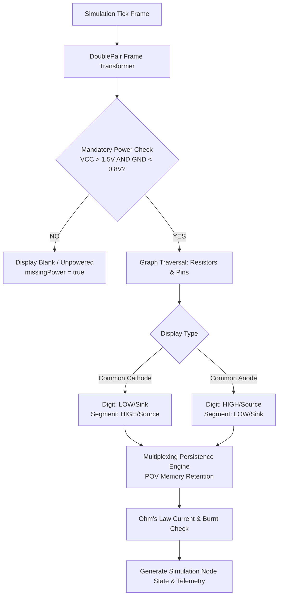

# DoublePair (4-Digit) 7-Segment Display Simulation Engine Documentation

**Source File:** [`src/lib/simulation/frameTransformers/DoublePair_7segmentDisplay.ts`](file:///d:/Tinker/circuit/src/lib/simulation/frameTransformers/DoublePair_7segmentDisplay.ts)  
**UI Component:** [`src/components/nodes/DoublePair_7segmentDisplay.tsx`](file:///d:/Tinker/circuit/src/components/nodes/DoublePair_7segmentDisplay.tsx)  
**Catalog Definition:** [`src/lib/circuit-components.ts`](file:///d:/Tinker/circuit/src/lib/circuit-components.ts) (`doublePair7Segment` / `DoublePair_7segmentDisplay`)

---

## 1. Overview & Architecture

The `DoublePair_7segmentDisplay` frame transformer simulates a **4-Digit, 7-Segment Display Module with Decimal Points and Center Colon**. It models realistic electrical physics, multi-digit time-division multiplexing (Persistence of Vision), series resistance traversal, Ohm's law current calculations, overcurrent burn-out behavior, and strict power rail verification (`VCC` + `GND`).



---

## 2. 16-Pin Package Definition

The module exposes 16 pins arranged in top and bottom dual-in-line rows:

| Pin ID | Label | Pin Type | Description |
| :--- | :--- | :--- | :--- |
| `dig1` | DIG1 | Common Digit 1 | Common Cathode / Anode control for Digit 1 (leftmost) |
| `a` | A | Segment A | Top horizontal bar |
| `f` | F | Segment F | Top-left vertical bar |
| `dig2` | DIG2 | Common Digit 2 | Common Cathode / Anode control for Digit 2 |
| `dig3` | DIG3 | Common Digit 3 | Common Cathode / Anode control for Digit 3 |
| `b` | B | Segment B | Top-right vertical bar |
| `vcc` | VCC | Power Rail | Module supply voltage ($>1.5\text{V}$ required) |
| `sda` | SDA | Auxiliary / I2C | Optional serial data line |
| `e` | E | Segment E | Bottom-left vertical bar |
| `d` | D | Segment D | Bottom horizontal bar |
| `dp` | DP | Decimal Point | Dot indicator at the bottom-right of digit |
| `c` | C | Segment C | Bottom-right vertical bar |
| `g` | G | Segment G | Middle horizontal bar |
| `dig4` | DIG4 | Common Digit 4 | Common Cathode / Anode control for Digit 4 (rightmost) |
| `gnd` | GND | Power Rail | Module ground return path ($<0.8\text{V}$ required) |
| `scl` | SCL | Auxiliary / I2C | Optional serial clock line |

---

## 3. Mandatory Power Rail Validation

Unlike unpowered passive discrete LEDs, the 4-digit module requires connected power rails:

```typescript
const isVccConnectedAndPowered = pinReadings["vcc"]?.connected && pinReadings["vcc"].voltage > 1.5;
const isGndConnectedAndGrounded = pinReadings["gnd"]?.connected && (pinReadings["gnd"].grounded || pinReadings["gnd"].voltage < 0.8);
const isModulePowered = isVccConnectedAndPowered && isGndConnectedAndGrounded;
```

- If `VCC` is disconnected or below $1.5\text{V}$, or `GND` is floating, `isModulePowered` is `false`.
- When `isModulePowered` is `false`:
  - All digit segments are instantly forced `OFF` (`emptyDigits()`).
  - `telemetry.missingPower` is set to `true`.
  - The studio UI diagnostics tooltip reports: **"Missing Power Supply: The 4-digit 7-segment display requires both VCC (>1.5V) and GND (<0.8V) connections to operate."**

---

## 4. Operating Modes (Common Cathode vs Common Anode)

The module behavior changes dynamically based on the `displayType` property:

### A. Common Cathode (`Common Cathode`)
- **Common Digit Pins (`dig1` - `dig4`)**: Active **LOW** (must connect to Ground / Sink $\le 0.8\text{V}$).
- **Segment Pins (`a` - `g`, `dp`)**: Active **HIGH** (must connect to Voltage Source $> 1.5\text{V}$).
- Digit is activated when: `voltage < 0.8V` or `grounded`.
- Segment is activated when: `voltage > 1.5V`.

### B. Common Anode (`Common Anode`)
- **Common Digit Pins (`dig1` - `dig4`)**: Active **HIGH** (must connect to Voltage Source $> 1.5\text{V}$).
- **Segment Pins (`a` - `g`, `dp`)**: Active **LOW** (must connect to Ground / Sink $\le 0.8\text{V}$).
- Digit is activated when: `voltage > 1.5V`.
- Segment is activated when: `voltage < 0.8V` or `grounded`.

---

## 5. Persistence of Vision & Flicker-Free Multiplexing

In physical hardware, only **one digit is energized at a time**. The microcontroller scans digits in sequence at 50Hz–1000Hz. The human eye blends these fast pulses together into a solid 4-digit number.

### How the Simulation Engine Implements Multiplexing:
1. **Per-Node Memory (`multiplexPersistence`)**:
   Maintains the active state of all 4 digits across simulation ticks.
2. **Incremental Scanning Updates**:
   When a frame tick drives `dig1`, only digit 0's segments are refreshed in memory, while digits 1, 2, 3 remain preserved.
3. **Decay Window (400ms)**:
   During intermediate scanning cycles where all digit pins are momentarily floating/HIGH (ghosting avoidance), the persistence memory does **not** wipe. It only clears if the module is powered down or if no refresh occurs for over `400ms`:
   ```typescript
   if (!isModulePowered) {
     currentPersistence.digits = emptyDigits();
   } else if (anyDigitActiveThisTick) {
     currentPersistence.lastUpdated = frame.timestamp ?? Date.now();
   } else {
     const now = frame.timestamp ?? Date.now();
     if (now - currentPersistence.lastUpdated > 400) {
       currentPersistence.digits = emptyDigits();
     }
   }
   ```

---

## 6. Circuit Graph Traversal & Current Calculation

The engine traces wires through **Breadboards** and **Series Resistors** to calculate the real current through each segment:

1. **Graph Traversal (`resolveConnectedEndpoint`)**:
   - Hops breadboard internal tie-point buses.
   - Accumulates series resistance along digit and segment lines ($R_{\text{total}} = R_{\text{dig}} + R_{\text{seg}} + R_{\text{shared}}$).
2. **Current Calculation (Ohm's Law)**:
   $$I = \frac{V_{\text{source}} - V_f}{R_{\text{total}}}$$
   Where the forward voltage drop $V_f \approx 3.0\text{V}$.
3. **Overcurrent & Burnout**:
   - If connected directly to $5\text{V}$ with no resistor ($R_{\text{total}} = 0\,\Omega$), $I = \infty$ ($>50\text{mA}$).
   - `telemetry.burnt` is set to `true`.
   - The display blanks out, and the UI reports **"7-Segment Display Damaged"**.

---

## 7. Telemetry Data Structure

Every simulation frame generates a `DoublePairTelemetry` object attached to the component node:

```typescript
export interface DoublePairTelemetry {
  digitsState: string;       // JSON string of active visible digits [[a..dp], [a..dp], [a..dp], [a..dp]]
  rawDigitsState: string;    // JSON string of raw logical digits (even when burnt)
  colon: boolean;            // Center colon active status
  isPowered: boolean;        // True if module is powered and at least one segment is glowing
  color: string;             // Display LED color ('red', 'blue', 'green', 'yellow', 'white')
  displayType: string;       // 'Common Cathode' or 'Common Anode'
  hasResistor: boolean;      // False if direct unresisted connection detected
  currentMilliAmps: number;  // Peak current across active segments in mA
  burnt: boolean;            // True if overcurrent damaged the display (>50mA)
  missingPower: boolean;     // True if VCC or GND is missing
}
```

---

## 8. Presets & Example Usage

### Example 1: Arduino Uno (Common Cathode)
```cpp
// 4-Digit 7-Segment (Common Cathode)
// Digits: D2..D5, Segments: D6..D13, VCC -> 5V, GND -> GND
const int digitPins[4] = {2, 3, 4, 5};
const int segmentPins[8] = {6, 7, 8, 9, 10, 11, 12, 13};

const byte digitPatterns[10] = {
  0b00111111, // 0
  0b00000110, // 1
  0b01011011, // 2
  0b01001111, // 3
  0b01100110, // 4
  0b01101101, // 5
  0b01111101, // 6
  0b00000111, // 7
  0b01111111, // 8
  0b01101111  // 9
};

void displayDigit(int digitIndex, int number) {
  for (int i = 0; i < 4; i++) digitalWrite(digitPins[i], HIGH); // Disable all digits

  byte pattern = digitPatterns[number % 10];
  for (int s = 0; s < 7; s++) {
    digitalWrite(segmentPins[s], (pattern >> s) & 1 ? HIGH : LOW);
  }
  digitalWrite(digitPins[digitIndex], LOW); // Enable active digit
  delay(5);
}

void loop() {
  displayDigit(0, 1);
  displayDigit(1, 2);
  displayDigit(2, 3);
  displayDigit(3, 4);
}
```

### Example 2: Arduino Uno (Common Anode)
```cpp
// 4-Digit 7-Segment (Common Anode)
// Digits: D2..D5, Segments: D6..D13, VCC -> 5V, GND -> GND
void displayDigit(int digitIndex, int number) {
  for (int i = 0; i < 4; i++) digitalWrite(digitPins[i], LOW); // Disable all digits

  byte pattern = digitPatterns[number % 10];
  for (int s = 0; s < 7; s++) {
    digitalWrite(segmentPins[s], (pattern >> s) & 1 ? LOW : HIGH); // Inverted segment bits
  }
  digitalWrite(digitPins[digitIndex], HIGH); // Enable active digit (HIGH)
  delay(5);
}
```

---

## 9. Verification & Automated Tests

Automated regression suite is located in:
- [`src/__tests__/doublePairSevenSegment.test.ts`](file:///d:/Tinker/circuit/src/__tests__/doublePairSevenSegment.test.ts)
- [`src/__tests__/runAllTests.ts`](file:///d:/Tinker/circuit/src/__tests__/runAllTests.ts)

### Test Cases Covered:
1. Component Catalog and NodeTypes Registration.
2. Common Cathode driving with series resistors on digits.
3. Common Anode driving with series resistors on digits.
4. Direct unresisted overcurrent burnout detection.
5. Raspberry Pi Pico ($3.3\text{V}$) MicroPython & C++ compatibility.
6. Multiplexing persistence across frame ticks.
7. Unpowered missing `VCC` verification.
8. Unpowered missing `GND` verification.
9. Circuit Presets wiring & code verification.
